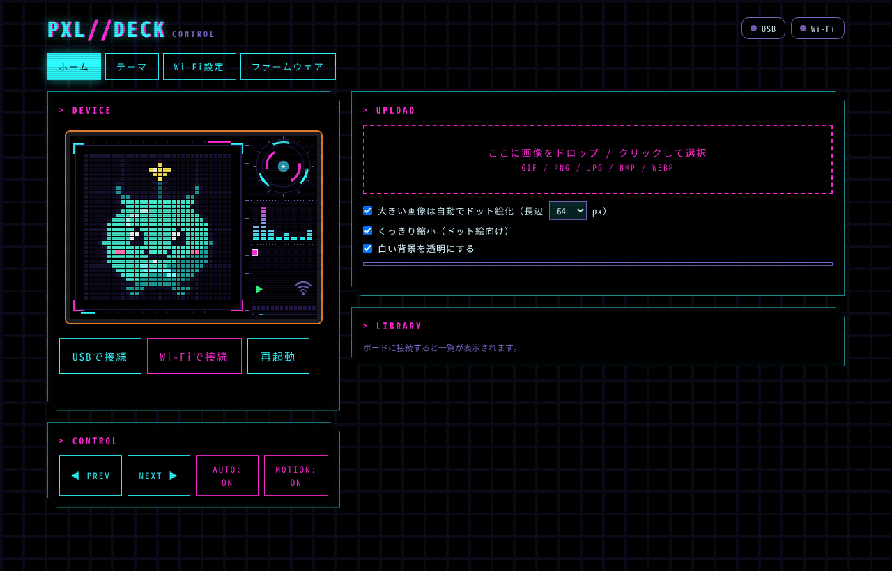
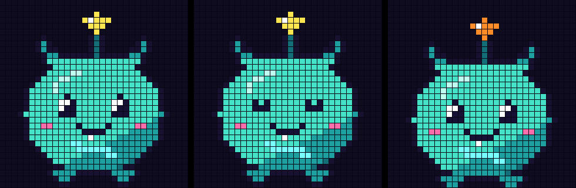
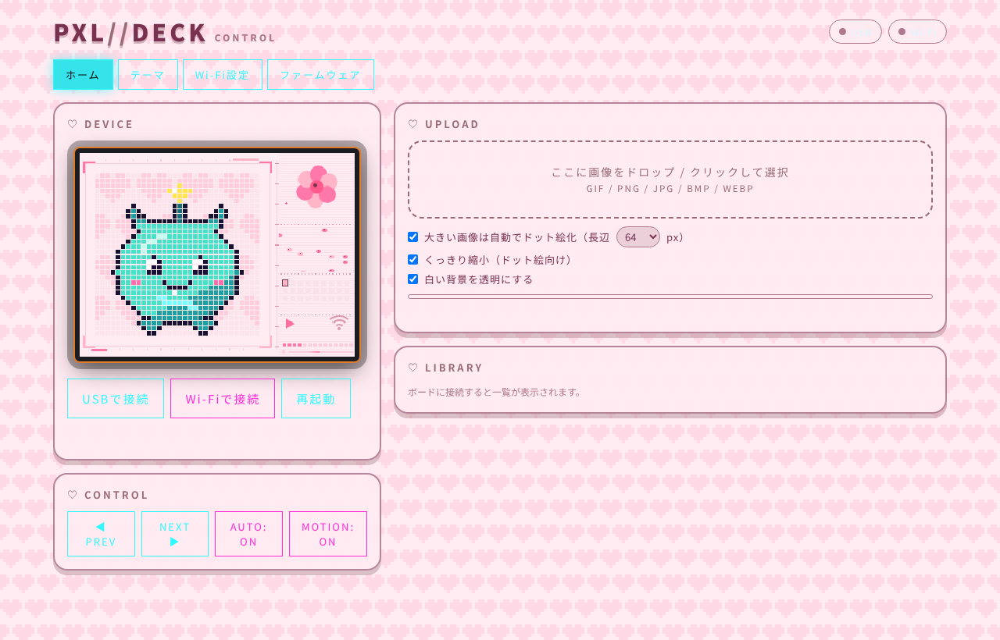
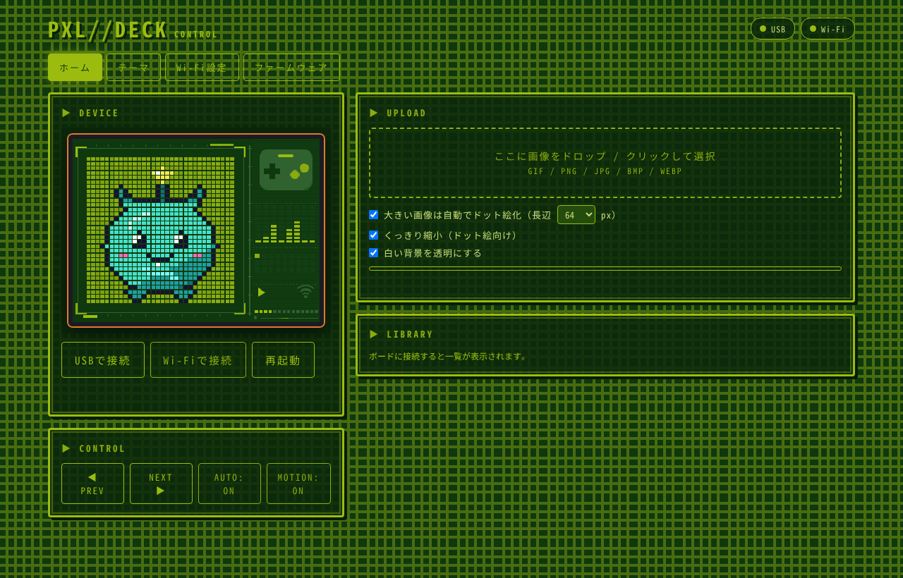
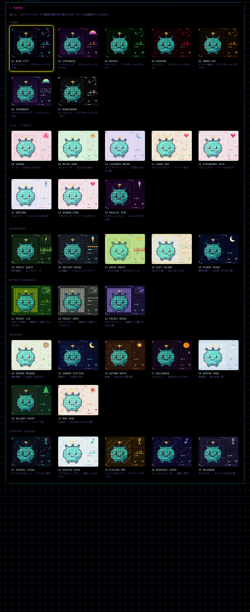
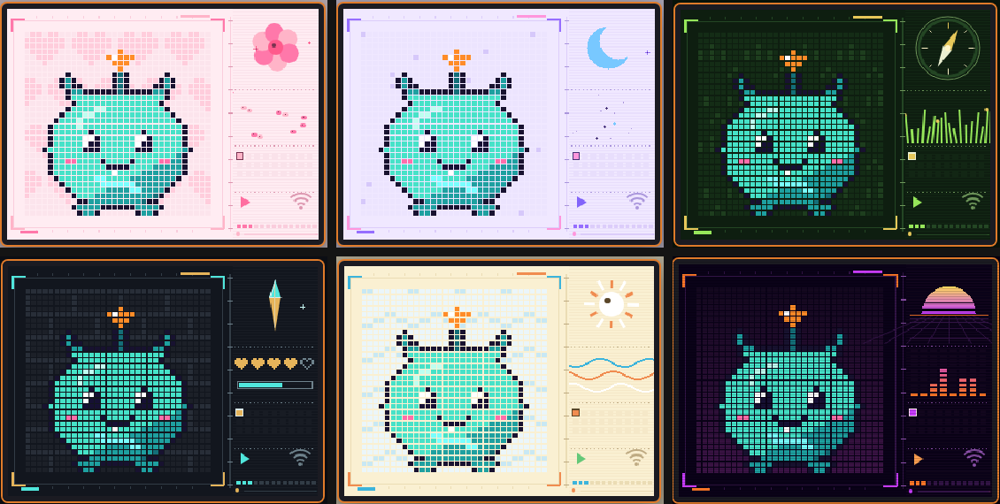
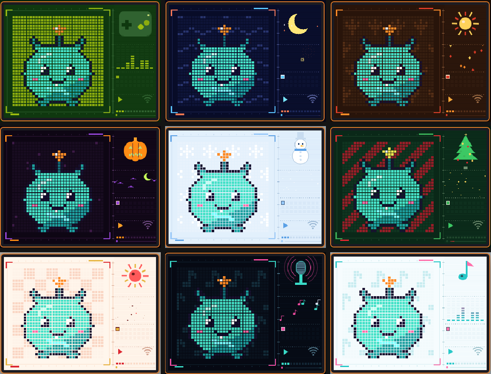
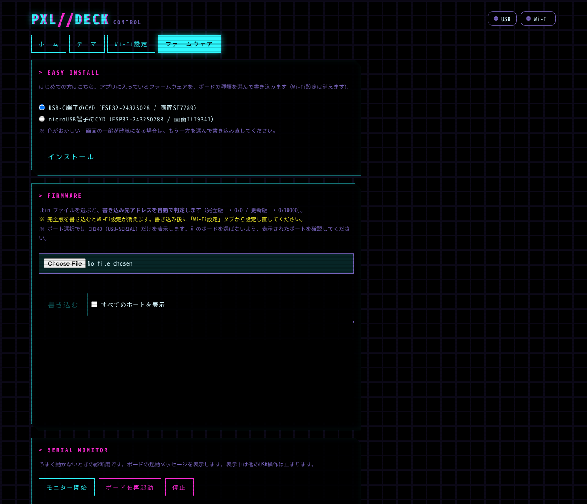
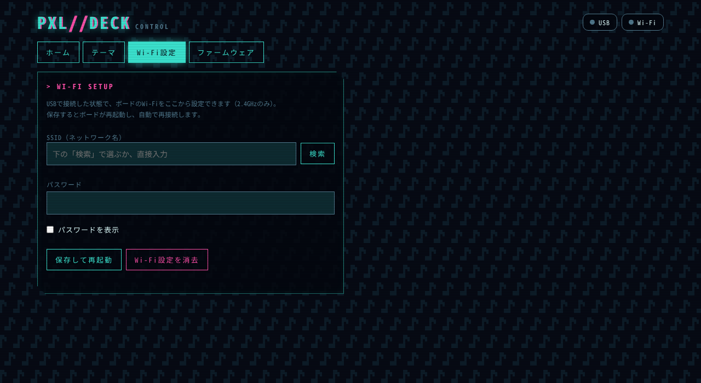

# PXL//DECK

**格安タッチ液晶ボード「CYD（ESP32-2432S028）」を、サイバーパンク風のドット絵パネルにするファームウェア＋操作アプリ**



- 🖼 GIFアニメ / PNG / JPG / BMP を、LEDマトリクス風に表示
- ✨ 静止画を自動でふわふわ上下させ、まわりに星がきらめくモーション機能
- 🎨 **35種類のテーマ**（サイバー / かわいい / 冒険 / レトロ携帯機 / 季節 / バーチャルシンガー）
  — 色・背景の模様・右側のアニメーション装飾がまるごと切り替わります
- 🔌 **USBでもWi-Fiでも操作**できる専用アプリ（HTMLファイル1つ、インストール不要）
- ⚡ アプリから**ファームウェアの書き込みも完結**（ボードの種類を選んでボタンを押すだけ）
- 📶 Wi-Fi設定はUSB経由でアプリから（近くのネットワークを検索して選択）
- 🛡 クラッシュ時は自動で原因を表示し、セーフモードで起動

内蔵キャラクター「Bitto（ビット）」付き。SDカードが無くても動きます。



---

## スクリーンショット

| かわいい系（さくら） | レトロ携帯機（ポケット液晶） |
|---|---|
|  |  |

### テーマ一覧


### テーマごとに変わるボード画面



---

## 必要なもの

- **CYD（Cheap Yellow Display）** ESP32-2432S028 / 2.8インチ 320×240 タッチ液晶
  - USB-C端子のモデル（画面 ST7789）と、microUSB端子のモデル（画面 ILI9341）に対応
- microSDカード（FAT32、32GB以下推奨）※無くても内蔵キャラは表示されます
- PC（Windows / Mac）と **Google Chrome または Microsoft Edge**（USB接続・書き込みに必要）

## インストール（3分）

1. このリポジトリの [`app/PixelDeck_Control.html`](app/PixelDeck_Control.html) をダウンロードして、Chrome / Edge で開く
2. ボードをUSBでPCにつなぐ
3. 「**ファームウェア**」タブ →「**EASY INSTALL**」でボードの種類を選んで「インストール」
4. ポート選択で、ボードのポート（USB-SERIAL CH340 など）を選ぶ
5. 書き込みが終わると自動で再起動します
6. 「ホーム」→「USBで接続」→「**Wi-Fi設定**」タブ →「検索」→ ネットワークを選んでパスワードを入力



> 💡 色がおかしい・画面の一部が砂嵐になる場合は、もう一方のボード種類を選んで書き込み直してください。
> 💡 ポートが見つからない場合は、CH340 のUSBドライバーをインストールしてください。
> 💡 書き込みが始まらない場合は、ボード裏の **BOOT ボタンを押したまま USB を挿して** から、もう一度「インストール」を押してください。

## 使い方

| 操作 | 方法 |
|---|---|
| 画像を入れる | アプリの「UPLOAD」に画像をドロップ（大きい画像は自動でドット絵化、白背景は自動で透明に） |
| 次の画像 | 画面をタップ / アプリの NEXT |
| 自動切替 ON/OFF | 画面を長押し（0.7秒）/ アプリの AUTO |
| ネットワーク情報を表示 | ボード裏の BOOT ボタンを1回押す |
| Wi-Fi設定を消す | BOOT を押したまま電源を入れて3秒 / アプリの「Wi-Fi設定を消去」 |

- 画像は **128×128 px 以下** がおすすめ（16〜64 px のドット絵がいちばん映えます）
- SDカードに直接入れる場合は `/pixel` フォルダに GIF / BMP を置いてください
  （PNG・JPG はアプリ経由で入れると自動変換されます）
- Wi-Fi接続時は、ブラウザで `http://pxldeck.local`（またはボードに表示されるIP）からも操作できます



## ファイル構成

```
app/PixelDeck_Control.html          操作アプリ（ファームウェア内蔵・これ1つでOK）
firmware/                           ファームウェア単体（.bin / アドレス 0x0 に書き込み）
  PixelDeck_v1.0_CYD-USBC_ST7789.bin
  PixelDeck_v1.0_CYD-microUSB_ILI9341.bin
firmware-src/PixelDeck/             ファームウェアのソース（Arduino）
docs/images/                        README用の画像
third_party_licenses/               使用ライブラリのライセンス
```

## ソースからビルドする場合

- Arduino IDE 2.x + ボードパッケージ **esp32 by Espressif 3.1.x**
- ボード：`ESP32 Dev Module` / Partition Scheme：`Huge APP (3MB No OTA)`
- ライブラリ：**LovyanGFX**、**AnimatedGIF**（bitbank2）
- 画面が ILI9341 のモデルは `PixelDeck.ino` の `PANEL_ST7789` を `0` にする

## 注意

- 個人が作ったものです。動作保証はありません。自己責任でお使いください。
- 表示する画像の権利は、各画像の権利者に帰属します。ご自身で使用する権利のある画像をお使いください。

## ライセンス

- このプロジェクトのコード：MIT License（[LICENSE](LICENSE)）
- 使用しているライブラリ：[THIRD_PARTY_NOTICES.md](THIRD_PARTY_NOTICES.md) を参照

---

### English (short)

PXL//DECK turns the ESP32-2432S028 "Cheap Yellow Display" into a cyberpunk-styled pixel-art panel.
Open `app/PixelDeck_Control.html` in Chrome/Edge, plug the board in via USB, go to **Firmware → EASY INSTALL**, pick your board type and click Install.
Then connect via USB, set up Wi-Fi from the **Wi-Fi** tab, and drop images into **UPLOAD**. 35 themes, GIF animation, idle motion, USB & Wi-Fi control.
